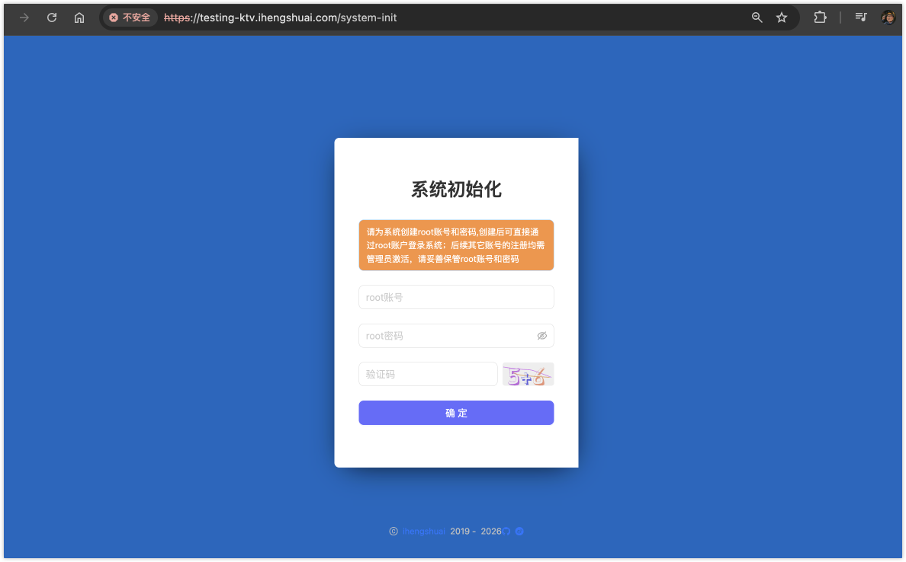

# KTV点歌系统(v2)

KTV点歌系统重构版(v2)，由 `管理端` 和 `用户端` 2部门组成

- 用户端：路径 `/` ，主要提供用户点歌服务
- 管理端：路径 `/admin`，主要提供管理员KTV维护、用户上机服务

## 环境变量
应用运行时默认会加载项目中的`.env`配置文件

参考默认的`.env.example`配置作为原始开发配置，然后根据 `NODE_ENV` 变量的值，来加载对应的 `.env.xxxx` 配置文件

最佳实践：

- 如果本地想调试或者通用的变量放在 `.env`
- 运行不同的脚本时加载对应的配置文件，如：`.env.development`、`.env.production`

### https
应用支持https，需要配置对应的证书，如：

- SSL_CERTIFICATE_KEY=/Users/certificates/domain.cc.key
- SSL_CERTIFICATE=/Users/certificates/domain.cc.crt

在配置了以上配置后，应用会自动变成https

### 多语言
项目默认支持`zh`和`en`两种语言，可自行参考配置

### 系统初始化
项目启动后初次会根据是否有ROOT用户来判断是否需要初始化系统，默认会跳转到 `初始化页面` 进行用户的初始化，此用户会作为唯一 `ROOT` 管理员，请妥善保管账号与密码




## 数据库
项目中使用`docker-compose`管理`MySQL`数据库，直接在项目根目录执行`docker-compose up -d`启动数据库

### 初始化
项目通过`TypeORM`进行数据库操作，在运行前先按步骤执行：

1. 配置好目标`数据库(MySQL)连接配置`及相应环境，并创建好对应的`数据库名字`：

```sh
DB_HOST=<YOUR HOST>
DB_PORT=<YOUR PORT>
DB_NAME=<YOUR NAME>
DB_USER=<YOUR USER>
DB_PWD=<YOUR PASSWORD>
```

> 读者部署时可自行通过构建容器镜像管理整个服务生命周期，本项目不做演示

2. 然后执行以下命令来初始化数据库表

```sh
pnpm run migration:run
```

### 数据库升级/迁移

```sh
# 生成迁移文件
pnpm run migration:generate ./src/migrations/(filename-path).ts
# 运行迁移
pnpm run migration:run
# 撤销迁移
pnpm run migration:revert
```

官方文档 👉🏻：[typeorm migration](https://typeorm.io/docs/advanced-topics/migrations)

## 存储
默认使用`阿里云OSS`作为存储服务，用户可根据 [阿里云文档](https://help.aliyun.com/zh/oss/developer-reference/node-js-1/) 进行设置

当然，如果你不想使用阿里云OSS，可以根据其他服务商自行调整，代码只需简单适配即可。

除了云储存外，也内置了本地存储，用户可将上传方式替换成对应的 `枚举` 即可

```ts
/** 文件存储位置 */
export enum FILE_LOCATION {
  /** 本地存储 */
  LOCAL = "LOCAL",
  /** 云存储 */
  OSS = "OSS",
}
```


## 开发
应用默认支持以下脚本：
```sh
# 开发
pnpm dev

# 打包
pnpm build
```

## API Docs
项目使用Swagger提供Api服务，请访问 `YourDomain:port/api/swagger-ui.html`

## 部署

```sh
pm2 start ecosystem.config.js --env production
```

请根据情况自行调整

## 注意事项

- 本项目涉及到前端及运维等大量知识面，请熟悉后再食用
- 本项目的前台点歌界面简单做了下，用户可自行发挥

## 博客
[https://blog.usword.cn](https://blog.usword.cn)

## 交流
扫描下方二维码，关注公众号『赋码空间（mslaicai）』


## 课程

👉🏻 [赋码空间](https://luckycoding.cn/course/?source=ktv-v2)

## 转载须知
本博客文章通常允许转载，需要注明出处并提供源文章链接，对于标注不允许转载的，请联系本人。

## 打赏
如果你觉得本博客对你有帮助，不介意的话打赏一杯咖啡，鼓励作者不断分享技术文章，在此感谢!:thumbsup:

If you think this blog is helpful to you, if you don't mind, enjoy a cup of coffee, encourage the author to continue to share technical articles, thank you here!

<div>


</div>